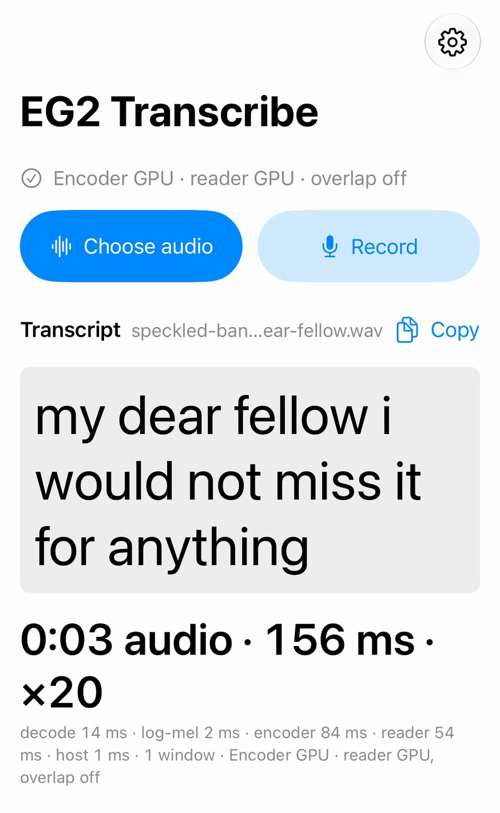

# EmbeddingGemma 2 Transcribe

English speech-to-text apps for iPhone, Mac and Android that run on the device, built on the audio encoder of Google's [EmbeddingGemma 2](https://huggingface.co/google/embeddinggemma-2). A small model trained with CTC, which I call the *reader*, picks an English word or a blank for each 40 ms of audio. The output has no punctuation or capitals. You record or choose an audio file, and the app transcribes it.

<p align="center">
<br>
A 3.1-second sentence in 156 ms, which the app shows as ×20. The app runs a full 30-second window even for a clip this short. <a href="https://github.com/john-rocky/coreai-assets/blob/main/demos/eg2-transcribe-coreai-iphone-20261016.mp4">Watch the video</a>.
</p>

Transcribing a 54-minute LibriVox recording of *The Adventure of the Speckled Band*, measured on 2026-10-15:

| Device | Runtime | Time | Times real time | Word error rate |
|---|---|---|---|---|
| iPhone 18 Pro | Core AI, GPU | 12.01 s | 271× | 3.81 % |
| Galaxy S26 | LiteRT, GPU, debug build | 140.8 s | 23.1× | 3.81 % |
| Pixel 8a | LiteRT, GPU, debug build | 300.8 s | 10.8× | 3.81 % |

The iPhone time covers only the encoder and reader runs. Reading the file and computing its features add about 0.7 s. The Android times include the features but not reading the file (2.8 s on the Galaxy and 5.4 s on the Pixel). The Mac app's numbers are in [Details](docs/details.md).

On LibriSpeech, the reader's word error rate in PyTorch is 4.21 % on test-clean and 10.42 % on test-other, with greedy decoding and no language model. The reader was trained only on read English audiobooks, and all of these tests are that kind of speech.

## Try it on an iPhone or a Mac

The apps run on Apple's Core AI, so they need iOS 27 or macOS 27. You need Xcode 27 and [XcodeGen](https://github.com/yonaskolb/XcodeGen):

```sh
cd ios
xcodegen generate
open EG2Transcribe.xcodeproj
```

Pick the `EG2Transcribe` scheme for an iPhone (set your team under Signing) or `EG2TranscribeMac` for the Mac. The app offers to download [the model folder](https://huggingface.co/mlboydaisuke/EmbeddingGemma-2-Transcribe-CoreAI). You can also copy it by hand, as [`ios/README.md`](ios/README.md#the-model-folder) describes.

## Try it on Android

You need Android 8.0 or newer on arm64. In `android/`:

```sh
./gradlew :app:assembleDebug
adb install -r app/build/outputs/apk/debug/app-debug.apk
```

Then download the five [model files](https://huggingface.co/mlboydaisuke/EmbeddingGemma-2-Transcribe-LiteRT) and put them on the phone with `adb push`. [`android/README.md`](android/README.md#the-model-files) has the paths.

## Where the idea came from

The idea comes from a post by Shahir (@TslShahir) and the *Embedding Gemma Transcribe* Mac app ([eg2.haku.sh](https://eg2.haku.sh)). I built this separately. This repository is not affiliated with Google.

## Documentation

- [Details](docs/details.md): how the reader works, word error rates and Core AI timings
- [Release notes for the reader model](reader/RELEASE.md): its training recipe and known weaknesses
- [Reader model weights](https://huggingface.co/mlboydaisuke/EmbeddingGemma-2-Transcribe-Reader)

## License

Apache-2.0 for the code in this repository. EmbeddingGemma 2 weights are Apache-2.0, and deployments must follow the Gemma Prohibited Use Policy. The reader is trained on LibriSpeech (CC BY 4.0).
